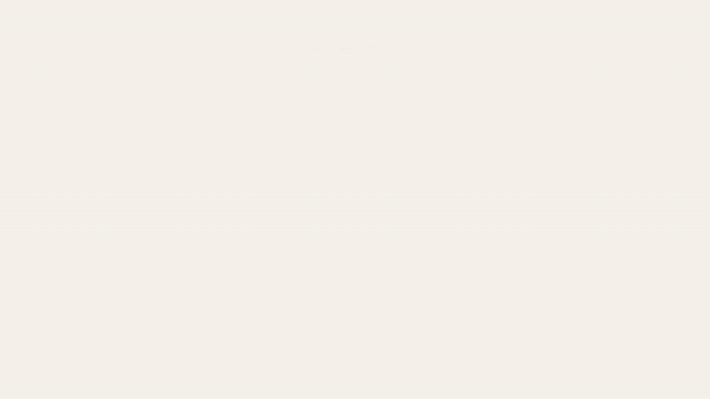

# Codex Observatory

**让每一次生成，成为一场光影演出。**

把监控做成桌面艺术，把路由状态亮在眼前。六层玻璃、流线、粒子与动态文字，把正在工作的 Codex 变成一座发光观测站——赏心悦目，也有据可看。

[English — 内容逐项对应](README.en.md) · [下载 0.4.9-r1](https://github.com/amanter-Zthen/CodexObservatory/releases/tag/v0.4.9-r1) · [4K / 60 fps 完整演示](https://github.com/amanter-Zthen/CodexObservatory/releases/download/v0.4.9-r1/CodexObservatory-0.4.9-4K60.mp4)

[](https://github.com/amanter-Zthen/CodexObservatory/releases/download/v0.4.9-r1/CodexObservatory-0.4.9-4K60.mp4)

*动图是轻量预览；完整视频为 3840 × 2160、60 fps、37 秒、2220 帧，含配乐。合成快照经过实际组装页面，展示无模型入场 → 一绿 → 两行含黄 → 四行含红与 gpt-6-astra → 新回合全绿 → 收拢 → 消散。*

## 好看，也要看得明白

- **让路由状态可见。** 比较请求与响应报告的模型标签，以绿、黄、红区分一致、待核验和本回合已观测的标签异常。异常留在当前回合中，后续一次匹配不会把它抹掉。
- **让状态变化有美感。** 玻璃升起、镜头拉远、模型文字逐字入场、刻度向两侧展开；输出时光流与数字一起运动，结束时先收拢，再消散。
- **六层完整开放。** 玻璃背景、流动曲线、漂浮光点、外框刻度、信息文字、前景泛光，均提供源码、独显预览与修改入口。
- **悬浮在工作旁边。** Windows 原生透明宿主复用系统 WebView2，支持置顶、拖动、缩放、画质设置、当前状态菜单与路由同步。r1 将完整视觉窗口设为输入穿透，用独立小圆角输入窗口覆盖面板，让泛光外缘的点击落到下方应用。
- **半实时，先求顺畅。** 最新状态合并、有限缓存、预热、单帧 GPU 背压与平滑估速，让动画完整性和响应能力优先于逐毫秒追赶。数字采用 0.4.8 的 0.65 秒插值节奏。
- **五秒轻量触发。** 自动 pulse 唤醒已有的增量读取，不积累补发队列。悬浮层不带会话历史；原后端仍保留本地证据与记录功能。

模型标签比较提供路由线索，不能独立认证服务实际运行的模型权重。输出速率是半实时估算；详见 [接口与状态](docs/API.zh-CN.md)。

## 先看画面

下载源码后，直接用支持 WebGL2 的浏览器打开 [`visual/index.html`](visual/index.html)。右侧控制区可以选择模型数量、状态颜色、输出、额度、镜头、画质，以及六层独显。这个预览使用合成数据，无需后端或 Node。

使用 [Windows x64 Release](https://github.com/amanter-Zthen/CodexObservatory/releases/tag/v0.4.9-r1) 时，解压后运行：

```powershell
.\desktop\CodexObservatory.exe --preview
```

`desktop/` 内是透明显示程序，根目录同名 EXE 是 Go 后端。运行显示需要系统 WebView2 Runtime。实时采集的配置步骤见 [接入自己的 Codex](docs/INTEGRATION.zh-CN.md)；预览不会替你启用采集。

## 六层工程

| 图层 | 画面职责 | 源码与预览 |
| --- | --- | --- |
| 01 · 玻璃背景 | 阵列、升降、光学材质、无模型与有模型镜头 | [清单](layers/01-background.json) · [预览](media/layer-background.png) |
| 02 · 流动曲线 | 长波与分流，在 2 / 4 个会话处增强数量变化 | [清单](layers/02-curves.json) · [预览](media/layer-curves.png) |
| 03 · 漂浮光点 | 光点、碎光及有界粒子 | [清单](layers/03-particles.json) · [预览](media/layer-particles.png) |
| 04 · 外框刻度 | 外框、端点、刻度与身份线条 | [清单](layers/04-frame.json) · [预览](media/layer-frame.png) |
| 05 · 信息文字 | 模型名、输出估速、额度、逐字动效与流光 | [清单](layers/05-info.json) · [预览](media/layer-info.png) |
| 06 · 前景泛光 | 入场暖光、发光合成、宽范围柔和收束 | [清单](layers/06-glow.json) · [预览](media/layer-glow.png) |

六层共用一套时间轴、布局和合成器；清单指向实际源文件，避免复制出六套互相漂移的工程。当前 39 个运行脚本的 SHA-256 固定在 [`layers.lock.json`](layers.lock.json)。详见 [图层、参数与动画顺序](docs/LAYERS.zh-CN.md)。

r1 的玻璃状态与实际快照联动：变化体现在玻璃片状态标记、墨色和对应档案，香槟暖色材质继续保留。离线演示也逐帧更新玻璃，使用与交互页面相同的状态驱动链。

## 接口、构建与验证

| 需要做什么 | 文档 |
| --- | --- |
| 接入自己的 Codex、配置 Home、采集与显示 | [接入说明](docs/INTEGRATION.zh-CN.md) |
| 理解快照、路由颜色、输出、新鲜度和同步状态 | [接口与状态契约](docs/API.zh-CN.md) |
| 从源码构建后端、伴随程序和透明宿主 | [构建与打包](docs/BUILD.zh-CN.md) |
| 调整六层艺术效果与动作顺序 | [六层工程](docs/LAYERS.zh-CN.md) |
| 检查本次公开版本的验证范围 | [验证记录](docs/VALIDATION.zh-CN.md) |
| 复现高清演示和了解上传体积 | [演示制作](docs/MEDIA.zh-CN.md) |

```text
native/              0.4.8-nacre 原生源码、测试和 vendored 依赖
deployment/overlay/  0.4.9 后端覆盖层与状态接口
desktop/             C++ / WebView2 透明悬浮宿主
visual/              当前唯一的六层视觉工程
layers/              六层分别对应的源文件与哈希清单
interfaces/          快照字段结构
tests/               合成场景与回归检查
tools/               可移植构建、打包与离线渲染
docs/                逐项对应的中英文文档
```

单独构建 `native/` 得到旧显示基线；请使用覆盖层构建和 `desktop/` 宿主组合交付 0.4.9。后端 API 保留 `0.4.8-nacre` 版本标记。完整采集需要显式设置 Codex 的本地代理、证书和跟随配置；安装步骤与显示预览分开说明。

## 感谢与来源

特别感谢 **路北路陈（LBEILC）** 的 [RhineLabUI](https://github.com/LBEILC/RhineLabUI)。本项目的部分视觉灵感来自这一作品，其公开源码也为部分布局与运动机制提供了直接帮助。我们保留了相关源码中的改编署名与 MIT 许可；具体来源固定到 [`ee5779741c6c0c916e416705fa634c7abf905c73`](https://github.com/LBEILC/RhineLabUI/tree/ee5779741c6c0c916e416705fa634c7abf905c73)。

也感谢《明日方舟》特别映像「莱茵生命：访问」所呈现的视觉语言。Codex Observatory 是独立的非官方工具。完整说明见 [中英文致谢](ACKNOWLEDGMENTS.md) 与 [第三方许可](THIRD_PARTY_NOTICES.md)。

演示配乐：**DJ烬冷冷、情冷冷 — Claude Remotion（浴室氛围版）**。项目代码采用 [MIT](LICENSE)；第三方代码、音乐及相关名称和品牌分别适用其权利归属，音乐不随本项目代码许可再授权。
